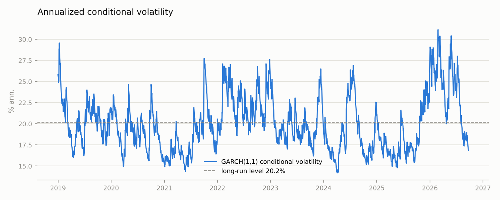
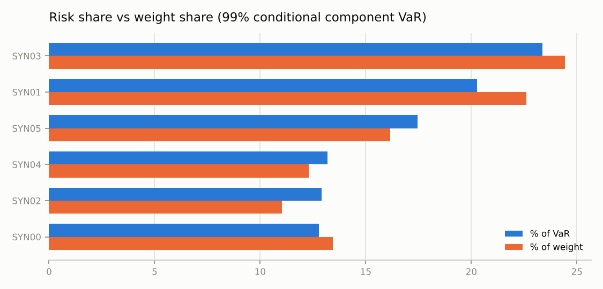
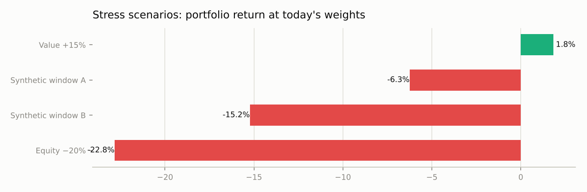
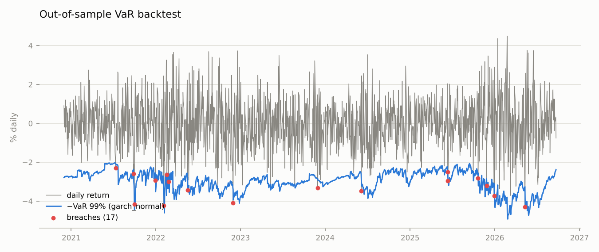
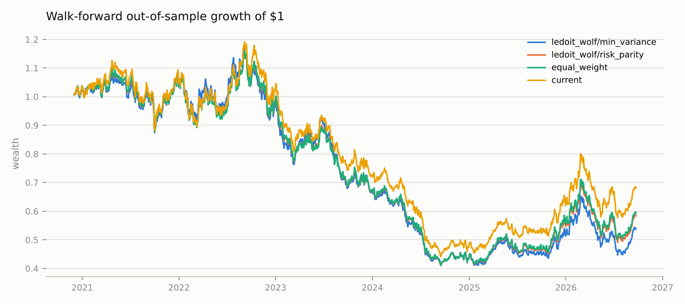

# Risk report: Synthetic demo portfolio

Generated 2026-11-02 15:22. Data: 2019-01-01 → 2026-09-22 (2016 trading days, 6 holdings). Value 100,000 (config override). Source: `csv`.

## 1. Portfolio

| ticker | weight_% | sector | risk_% (VaR) |
|---|---|---|---|
| SYN00 | 13.45 | Technology | 12.78 |
| SYN01 | 22.62 | Technology | 20.28 |
| SYN02 | 11.02 | Financials | 12.92 |
| SYN03 | 24.44 | Healthcare | 23.38 |
| SYN04 | 12.30 | Energy | 13.18 |
| SYN05 | 16.16 | Industrials | 17.46 |

### Concentration

Effective number of positions by weight **5.5**, by risk **5.7** (1/Herfindahl). Top-1 holding 24.4% of weight and 23.4% of VaR; top-5 89.0% / 87.2%.

### Sectors
| sector | weight_% | risk_% | n_holdings |
|---|---|---|---|
| Technology | 36.1 | 33.1 | 2 |
| Healthcare | 24.4 | 23.4 | 1 |
| Industrials | 16.2 | 17.5 | 1 |
| Energy | 12.3 | 13.2 | 1 |
| Financials | 11.0 | 12.9 | 1 |

### Risk profile (daily-rebalanced at today's weights)

| index | daily_rebalanced | buy_and_hold |
|---|---|---|
| ann_vol | 0.2028 | 0.2095 |
| max_drawdown | -0.6302 | -0.6503 |
| skew | 0.0020 | 0.0040 |
| kurtosis | 0.3014 | 0.4118 |
| hit_rate | 0.5064 | 0.5055 |
| n_obs | 2016 | 2016 |

### Trailing-window performance

These are the figures to compare with a benchmark. The full-sample row, and all return statistics, describe today's weights applied to the past — hindsight, not expectation (see appendix).

| window | ann_return | ann_vol | sharpe | max_drawdown | n_obs | start |
|---|---|---|---|---|---|---|
| 1y | 0.2990 | 0.2535 | 1.1587 | -0.2795 | 252 | 2025-10-06 |
| 3y | -0.0521 | 0.2069 | -0.1553 | -0.4417 | 756 | 2023-10-31 |
| 5y | -0.0721 | 0.2103 | -0.2506 | -0.6302 | 1260 | 2021-11-24 |
| full | -0.0413 | 0.2028 | -0.1066 | -0.6302 | 2016 | 2019-01-01 |

## 2. Factor model (OLS, Newey-West HAC, 7 lags)

Portfolio variance explained by factors: **85.9%**. Factors: MKT=MKT, SIZE=SIZE, VALUE=VALUE. Proxied holdings' betas use real data only (`real_only` column).

### Portfolio exposures
| factor | exposure |
|---|---|
| MKT | 1.142 |
| SIZE | -0.006 |
| VALUE | 0.122 |

### Variance decomposition (annualized)
| source | variance | vol | pct_of_total |
|---|---|---|---|
| MKT | 0.0349 | 0.1869 | 85.3773 |
| SIZE | 0.0000 | 0.0011 | 0.0032 |
| VALUE | 0.0002 | 0.0139 | 0.4744 |
| idiosyncratic | 0.0058 | 0.0761 | 14.1452 |
| total | 0.0409 | 0.2023 | 100.0000 |

### Per-asset betas
| ticker | MKT | SIZE | VALUE | r2 | idio_vol_ann | n_obs | real_only |
|---|---|---|---|---|---|---|---|
| SYN00 | 1.054 | -0.031 | 0.404 | 0.512 | 0.174 | 2016 | yes |
| SYN01 | 0.953 | 0.110 | 0.554 | 0.463 | 0.179 | 2016 | yes |
| SYN02 | 1.223 | 0.090 | 0.010 | 0.579 | 0.171 | 2016 | yes |
| SYN03 | 1.335 | -0.606 | 0.092 | 0.613 | 0.181 | 2016 | yes |
| SYN04 | 1.220 | 0.102 | -0.546 | 0.586 | 0.173 | 2016 | yes |
| SYN05 | 1.073 | 0.616 | -0.085 | 0.513 | 0.180 | 2016 | yes |

## 3. Volatility (portfolio returns)

GARCH(1,1) conditional volatility is **16.9%** annualized against a long-run level of 20.2%; shocks decay with a half-life of 27 days (persistence 0.975).

### Out-of-sample forecast comparison (rolling refit)
| model | qlike | mse | dm_vs_EWMA(0.94) | dm_pvalue |
|---|---|---|---|---|
| EWMA(0.94) | 1.362 | 6.791e-08 |  |  |
| GARCH(1,1) | 1.366 | 6.799e-08 | 0.4833 | 0.6289 |
| GJR-GARCH | 1.367 | 6.818e-08 | 0.6179 | 0.5367 |

Lower QLIKE is a better variance forecast; `dm_pvalue` < 0.05 means the difference from the first model is statistically significant (Diebold-Mariano).

## 4. VaR / ES (fraction of portfolio value; losses positive)

`VaR_lo`/`VaR_hi` are bootstrap 95% confidence intervals (historical: resampled days; FHS: resampled standardized residuals, GARCH parameters fixed). Multi-day historical rows are √h-scaled from the 1-day estimate. Monte Carlo uses the Ledoit-Wolf covariance. Methods and confidence levels are set by `risk.methods` and `risk.alphas`.

| method | horizon | alpha | VaR | ES | VaR_lo | VaR_hi | ES_lo | ES_hi | VaR_$ | ES_$ |
|---|---|---|---|---|---|---|---|---|---|---|
| Parametric normal | 1 | 0.9900 | 0.0297 | 0.0340 |  |  |  |  | 2971.6018 | 3404.4588 |
| Historical | 1 | 0.9900 | 0.0309 | 0.0353 | 0.0283 | 0.0330 | 0.0324 | 0.0376 | 3092.4950 | 3531.7916 |
| Filtered historical (GARCH) | 1 | 0.9900 | 0.0245 | 0.0282 | 0.0227 | 0.0268 | 0.0261 | 0.0302 | 2449.4392 | 2818.7157 |
| MC t-copula + empirical | 1 | 0.9900 | 0.0307 | 0.0350 |  |  |  |  | 3072.4055 | 3499.8635 |
| Parametric normal | 1 | 0.9750 | 0.0250 | 0.0299 |  |  |  |  | 2503.5949 | 2986.2340 |
| Historical | 1 | 0.9750 | 0.0256 | 0.0308 | 0.0235 | 0.0272 | 0.0289 | 0.0325 | 2556.1240 | 3078.1479 |
| Filtered historical (GARCH) | 1 | 0.9750 | 0.0211 | 0.0247 | 0.0199 | 0.0225 | 0.0234 | 0.0263 | 2111.3822 | 2468.3413 |
| MC t-copula + empirical | 1 | 0.9750 | 0.0245 | 0.0304 |  |  |  |  | 2453.1003 | 3039.8881 |
| Parametric normal | 10 | 0.9900 | 0.0940 | 0.1077 |  |  |  |  | 9397.0301 | 10765.8440 |
| Historical (√10-scaled from 1-day) | 10 | 0.9900 | 0.0978 | 0.1117 |  |  |  |  | 9779.3278 | 11168.5057 |
| Filtered historical (GARCH) | 10 | 0.9900 | 0.0843 | 0.0985 |  |  |  |  | 8425.1252 | 9852.3453 |
| MC t-copula + empirical | 10 | 0.9900 | 0.0888 | 0.0999 |  |  |  |  | 8882.4323 | 9987.0700 |
| Parametric normal | 10 | 0.9750 | 0.0792 | 0.0944 |  |  |  |  | 7917.0621 | 9443.3010 |
| Historical (√10-scaled from 1-day) | 10 | 0.9750 | 0.0808 | 0.0973 |  |  |  |  | 8083.1740 | 9733.9585 |
| Filtered historical (GARCH) | 10 | 0.9750 | 0.0714 | 0.0855 |  |  |  |  | 7137.7844 | 8553.3947 |
| MC t-copula + empirical | 10 | 0.9750 | 0.0755 | 0.0887 |  |  |  |  | 7547.5025 | 8868.9741 |

### Component VaR 99% 1-day (Euler, EWMA(0.94) conditional covariance)
| ticker | weight | marginal_var | component_var | pct_of_var | standalone_var |
|---|---|---|---|---|---|
| SYN00 | 0.1345 | 0.0220 | 0.0030 | 12.7832 | 0.0042 |
| SYN01 | 0.2262 | 0.0208 | 0.0047 | 20.2819 | 0.0070 |
| SYN02 | 0.1102 | 0.0272 | 0.0030 | 12.9208 | 0.0037 |
| SYN03 | 0.2444 | 0.0222 | 0.0054 | 23.3771 | 0.0077 |
| SYN04 | 0.1230 | 0.0249 | 0.0031 | 13.1817 | 0.0049 |
| SYN05 | 0.1616 | 0.0251 | 0.0041 | 17.4552 | 0.0062 |

Diversification benefit: 31.2% of the sum of standalone VaRs. The covariance is conditional, so the attribution reflects today's volatility like the FHS headline.

## 5. Stress tests
### Historical replay
| scenario | start | end | portfolio_return | direct | backfilled | proxied | missing | factors_missing |
|---|---|---|---|---|---|---|---|---|
| Synthetic window A | 2020-03-02 | 2020-04-15 | -0.0625 | 6 | 0 | 0 | 0 |  |
| Synthetic window B | 2023-01-03 | 2023-03-31 | -0.1523 | 6 | 0 | 0 | 0 |  |

Today's weights applied to each window. Per holding, the window return comes from its own prices (`direct`), its proxy-backfilled history (`backfilled`), its factor betas times the factor returns over the window (`proxied`, idiosyncratic part zero), or is unavailable (`missing`, contributes 0). `factors_missing` lists factors whose ETFs did not trade in the window and so were left out of the `proxied` mapping. Price history for the replays is downloaded back to `stress.history_start`, independently of the estimation window.

### Hypothetical factor shocks
| scenario | portfolio_return | shock | ignored_factors |
|---|---|---|---|
| Equity −20% | -0.2284 | MKT -20% |  |
| Value +15% | 0.0184 | VALUE +15% |  |

Rate shocks are mapped through equities the way 2022 transmitted them (per +100bp: MKT -10%, VALUE +7%); see `stress.RATE_SHOCK_PER_100BP`.

## 6. VaR backtest (99%, 1516 out-of-sample days, window 500)
| method | n_days | breaches | expected | breach_rate_% | kupiec_p | christoffersen_p | cc_p | traffic_light_250d | traffic_light_full | es_Z2 | es_p | avg_VaR_% | max_loss_% |
|---|---|---|---|---|---|---|---|---|---|---|---|---|---|
| normal | 1516 | 23 | 15.1600 | 1.5172 | 0.0601 | 0.3592 | 0.1121 | red | yellow | 0.5858 | 0.0210 | 2.8915 | 4.3030 |
| historical | 1516 | 21 | 15.1600 | 1.3852 | 0.1543 | 0.2943 | 0.2092 | yellow | green | 0.4344 | 0.0545 | 2.9208 | 4.3030 |
| garch_normal | 1516 | 17 | 15.1600 | 1.1214 | 0.6413 | 0.1828 | 0.3694 | green | green | 0.1254 | 0.3125 | 3.0060 | 4.3030 |
| fhs | 1516 | 20 | 15.1600 | 1.3193 | 0.2337 | 0.2640 | 0.2637 | green | green | 0.3224 | 0.1095 | 3.0308 | 4.3030 |

Best model by coverage among those passing conditional coverage: **garch_normal**. `garch_normal` uses a normal quantile on a GARCH σ, so comparing it with `fhs` (same σ, empirical tails) isolates the tail assumption. Models are set by `backtest.methods`. `es_Z2` > 0 means realized losses beyond VaR exceeded ES; `es_p` is the one-sided bootstrap probability. `traffic_light_250d` is the Basel zone on the last 250 days only; `traffic_light_full` applies the same binomial thresholds to the whole backtest.

## 7. Allocation reference
### Walk-forward out-of-sample (window 500, rebalance every 126 days)
| portfolio | ann_return | ann_vol | sharpe | max_drawdown | calmar | avg_turnover |
|---|---|---|---|---|---|---|
| sample/min_variance | -0.0981 | 0.1990 | -0.4194 | -0.6489 | -0.1512 | 0.1660 |
| sample/risk_parity | -0.0857 | 0.2019 | -0.3427 | -0.6474 | -0.1324 | 0.0228 |
| ledoit_wolf/min_variance | -0.0982 | 0.1990 | -0.4197 | -0.6490 | -0.1513 | 0.1630 |
| ledoit_wolf/risk_parity | -0.0857 | 0.2019 | -0.3426 | -0.6474 | -0.1323 | 0.0226 |
| equal_weight | -0.0831 | 0.2031 | -0.3258 | -0.6472 | -0.1285 | 0.0000 |
| current | -0.0619 | 0.2046 | -0.2102 | -0.6302 | -0.0983 | 0.0000 |

Min-variance and risk parity need no expected-return estimate; max-Sharpe and target-vol allocators remain in `risklib.models.optimize` but are not reported because their out-of-sample results are dominated by return-estimation error.

## Appendix: full-sample return statistics (hindsight)

Today's weights applied to the whole history. Because the weights are on stocks that have already performed, these figures overstate what the portfolio could have been expected to earn; they are kept for completeness only.

| index | daily_rebalanced | buy_and_hold |
|---|---|---|
| ann_return | -0.0413 | -0.0282 |
| sharpe | -0.1066 | -0.0316 |
| sortino | -0.1496 | -0.0445 |
| calmar | -0.0655 | -0.0433 |
| start | 2019-01-01 | 2019-01-01 |
| end | 2026-09-22 | 2026-09-22 |

---
*Generated by risklib. Every table is reproducible from `data/*.csv` with `data.source: csv`.*
